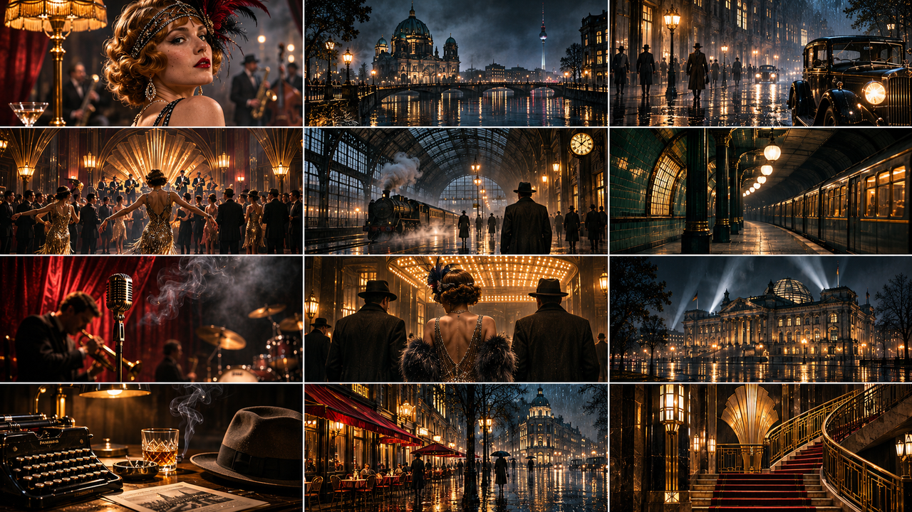

# Babylon Berlin — Omarchy theme

## Install — one line

```bash
curl -fsSL https://raw.githubusercontent.com/RobbieUK1/omarchy-babylon-berlin-theme/main/install.sh | bash
```

Installs and applies the complete theme, including the **integrated multi-monitor wallpaper randomizer**. Requires Omarchy's Quickshell background renderer, Python 3, Git and curl. The installer checks the installed renderer source before making changes and stops on unsupported versions or conflicting custom renderers. Legacy swaybg-only releases are unsupported.



A fan-made 1920s Berlin noir / Art Deco theme, unaffiliated with the television production. The supplied palette combines near-black backgrounds, true-black deepest surfaces, antique gold, burgundy, jade and smoky blue accents.

## Twelve wallpapers

All twelve images are **3840 × 2160 (16:9)**. They originated as parts of a generated collage and were upscaled to these dimensions; they are not native-detail 4K renders. This publication preserves the supplied ZIP's artwork, palette and preview.

## Wallpaper picker and multiple monitors

Use Omarchy's normal wallpaper picker or `omarchy theme bg next`. Selecting an image triggers a fresh randomized set across connected screens; the clicked image is not necessarily retained on a display. Cancelling the picker leaves the current set alone.

- Different images across displays when there are enough images.
- Each display changes from its previous image whenever the collection permits.
- Outputs are identified by their current names and re-enumerated on connection or disconnection.
- One screen, one image, empty collections and more screens than images are handled.
- Theme images and still images added to `~/.config/omarchy/backgrounds/babylon-berlin/` participate, including filenames with spaces and Unicode.
- Switching to a theme without an enabled `wallpaper-randomizer.json` restores the normal renderer behavior.

This uses the shared `crows.background` Quickshell clone from the author's Murder of Crows theme. An identical existing copy is reused, preserving Murder of Crows and Sunny OLED integration. The installer does not replace packaged Omarchy files or kill wallpaper processes. No polling service is needed. The earlier ZIP's swaybg service has been superseded; if you previously installed that ZIP, disable it before installing this version:

```bash
systemctl --user disable --now babylon-berlin-wallpapers.service
```

## Local install and rollback

From a complete checkout or extracted archive:

```bash
bash install.sh
```

Before changes, setup prints a backup directory under `~/.local/state/omarchy/backups/babylon-berlin-<timestamp>/` containing previous theme, plugin and shell settings when present. Unknown custom wallpaper renderers are preserved and cause setup to stop for explicit migration.

Disable randomization for Babylon Berlin while keeping the theme and other themes' shared integration:

```bash
bash ~/.config/omarchy/themes/babylon-berlin/install.sh --remove
```

Reinstall to enable it again. Switch themes with `omarchy theme set <name>`. To restore an earlier theme revision, copy the saved `theme/` folder from the printed backup to `~/.config/omarchy/themes/babylon-berlin/`, then select the theme again. Renderer backups remain available for manual recovery; disabling Babylon Berlin does not disable the renderer needed by other themes.

## Verification

Automated checks cover 1,000 reshuffles, no duplicates or repeats with sufficient images, monitor-list changes, empty/single/short collections, theme scoping, unusual filenames, installed-source compatibility, and isolated setup/disable behavior. The installer is tested from both a local checkout and its piped form using temporary fixtures. No live desktop installation or live multi-monitor test was performed for this theme.

Shared integration source and upstream revision: [UPSTREAM.md](UPSTREAM.md).
